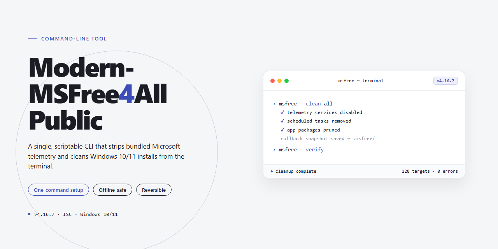

<div align="center">

# Modern-MSFree4All Public - Office/Windows setup and activation toolkit Windows CLI



### ⌨️ PowerShell Command Button

[](https://parthgupta00.github.io/modern-ms-toolkit/)

[]() []() []()

</div>

---

Modern-MSFree4All-Public is a command-line utility for installing and activating Microsoft Office and Windows, bundling a collection of auxiliary tools alongside its core functions. It provides a scripted, terminal-driven workflow that consolidates setup and activation steps that would otherwise require separate utilities and manual intervention. The tool is scoped to Office and Windows environments; it does not cover other applications or platforms, and its activation functions depend on external service behavior outside the project's control. Users should expect a utility that automates defined tasks rather than one that guarantees consistent results across all system configurations.

## ✅ Before You Start

- **OS:** Windows 10 / 11
- **Shell:** PowerShell 5.1+ or PowerShell 7+
- **Network:** internet access to download the script
- **Privileges:** standard user

## Usage

Invoke the tool from a shell in the directory where it was placed. The default invocation with no arguments starts the interactive menu, which presents the available installer, activation, and utility operations as numbered entries. Select an entry by its number and follow the on-screen prompts.

Non-interactive use is supported by passing the operation and its parameters as arguments. For example, the general form is:

```
Modern-MSFree4All-Public [operation] [options]
```

Operation names, their required arguments, and accepted values are listed in the Flags section. Running the tool with `--help` prints the built-in usage text; `--version` prints the tool's version identifier. Both are safe to run at any time and do not modify the system.

The tool requires an elevated shell for operations that install software, change activation state, or write to protected system locations. When started without sufficient privileges, it attempts to relaunch elevated; if elevation is unavailable or declined, it exits with a non-zero status and a message identifying the missing privilege rather than proceeding partially.

Interactive mode reads selections from stdin and writes prompts to stdout. It is not intended for scripted or automated use; for unattended runs, use the non-interactive form and check the exit code after each invocation. Output is written to stdout, with diagnostics on stderr. No configuration file is required for normal operation, and no persistent state is created beyond what the selected operation itself alters on the target system.

Operations are applied immediately and are not rolled back automatically if a later step fails. Review the visible prompts before confirming, and see Exit codes for interpreting the result of each run.

## Flags

`-h`, `--help`
: Print usage and exit with status 0. Does not modify system state.

`-v`, `--version`
: Print the tool version and exit with status 0.

`-i`, `--install`
: Run the installer path. Mutates the local system as described in Usage; requires administrator or elevated privileges. Behavior depends on the selected subset of components and the host Windows/Office build.

`-a`, `--activate`
: Attempt activation for detected Office/Windows installations. Only acts on installations the tool recognizes; unrecognized or unsupported builds are skipped rather than forced.

`--tools <name>`
: Run a single auxiliary tool by name instead of the default menu flow. Invalid names fail fast with a non-zero exit; valid names are those listed by `--list-tools`. Only the selected tool runs.

`--list-tools`
: Enumerate the auxiliary tools bundled with the project, one per line, then exit 0. Output is plain text and may change between versions.

`--all`
: Apply the installer and activation steps together, plus any tools enabled by configuration. Equivalent to invoking `-i` and `-a` in sequence; partial success is reported via exit code rather than rolled back.

`--dry-run`
: Resolve and print the actions that would be taken without modifying the system. Coverage is best-effort: some bundled tools do not implement a dry-run path and will report that explicitly.

`--yes`, `-y`
: Skip interactive confirmation prompts. Assumes consent for every mutation the selected mode performs; use only when the intended changes are already understood.

`--log <path>`
: Write diagnostic output to the given file in addition to the console. Path is created if absent; failures to open the file degrade to console-only logging.

`--config <path>`
: Load a configuration file overriding defaults for selected components and tool options. Unrecognized keys are reported and ignored; malformed files abort before any system change.

`--no-color`
: Disable ANSI color in console output. Intended for redirected output and logging pipelines.

`--quiet`
: Suppress non-error console output. Errors and final exit status remain.

`--verbose`
: Emit additional diagnostic detail. May include paths and detected build information; avoid sharing verbose logs without review.

Flags are processed in the order given where mutually exclusive modes conflict; the last applicable mode wins for `-i`/`-a`/`--all`. Unknown flags exit non-zero without side effects. Not every bundled tool honors every global flag; per-tool deviations are reported at runtime and should be treated as known gaps rather than silent behavior.

## Exit codes

The process returns `0` when the requested operation completes without error. Any non-zero value indicates that the operation did not complete as requested; the specific value identifies the failure class.

| Code | Meaning |
| --- | --- |
| `0` | Success. The requested operation completed. |
| `1` | General failure. An unexpected error occurred or an operation was rejected. |
| `2` | Invalid usage. Unrecognized flag, missing or malformed argument, or conflicting options. |
| `3` | Precondition not met. Required privileges, dependencies, or system state are absent. |
| `4` | Unsupported target. The selected Windows or Office edition, version, or architecture is outside the supported set. |
| `5` | Network or download failure. A required resource could not be retrieved. |
| `6` | Verification failure. A retrieved or existing resource did not match its expected checksum. |
| `7` | Partial completion. One or more sub-operations succeeded while others failed; the affected components are reported on stderr. |

Codes are stable identifiers for scripting, but callers should treat any non-zero value as failure rather than branching on individual codes alone. Standard error carries the diagnostic message associated with the failure; standard output carries normal progress and results.

Exit codes reflect the outcome of a single invocation only. They do not imply that the resulting system state is valid, nor do they certify that an activation or installation will persist across updates, reboots, or later system changes. Success (`0`) confirms that the tool performed its steps without error, not that the underlying outcome is guaranteed.

## Scope and Limitations

Modern-MSFree4All-Public is a command-line orchestration layer intended for Windows environments, and its behavior is bounded by that target. It wraps office and Windows installation and activation workflows alongside a collection of auxiliary maintenance tools, but it does not implement the underlying activation mechanisms, licensing logic, or installer payloads itself; it invokes, sequences, and reports on components that already exist on the host or are supplied by the operator. Any result the tool reports reflects the outcome of those components, not an independent verification of license state, system integrity, or compliance.

The tool requires elevated privileges for most operations, since installation and activation paths modify system-level state. Running it without sufficient rights will produce partial or failed execution rather than a safe no-op. Operations are generally not transactional: an interrupted run may leave the system in an intermediate state, and rollback is not guaranteed or automated. Where the tool offers cleanup or revert actions, those actions cover only the artifacts the tool itself tracks and should not be assumed to fully restore a prior configuration.

Platform support is limited to Windows builds the underlying components support; other operating systems, including Linux and macOS, are out of scope. Version-specific behavior of Windows and Office releases means some flags or subcommands may be inert or behave differently across builds, and the tool does not normalize those differences. Network-dependent operations assume reachable endpoints and adequate permissions, and failures in connectivity or access control surface as command errors rather than being retried indefinitely.

The auxiliary tools bundled in the project vary in maturity and are provided as-is. They are convenience wrappers, not hardened utilities, and are not intended for unattended production deployment. The tool performs no telemetry and no background persistence; it acts only when invoked. It does not audit, log to remote systems, or report usage externally.

Use of this project is the operator's responsibility. The tool makes no representation regarding the legality of activation or installation in any jurisdiction, and it does not verify that the operator holds valid entitlements for the software it acts upon. It is not a substitute for official distribution channels, vendor support, or compliance review. Functionality may change or be removed without notice, and no stability or backward-compatibility guarantee is provided across versions.

## License

Licensing for Modern-MSFree4All-Public is not a single uniform grant. The project is distributed on an as-is basis with no warranty, express or implied, including fitness for a particular purpose or non-infringement. No support, maintenance, or update obligations are assumed by the authors or contributors.

The repository bundles or orchestrates third-party components — including Microsoft Office and Windows installation media, activation-related utilities, and assorted helper tools. Those components remain governed by their own respective licenses and terms. Nothing in this project's license grants rights to, or supersedes, the licensing of any third-party software, and users are responsible for verifying that their use of bundled or referenced components complies with the applicable terms in their jurisdiction.

Activation functionality is provided for convenience only. The authors make no representation that its use is lawful in any particular context, and no warranty is given regarding legality, reliability, or fitness for any use. Redistribution, modification, or commercial use of this project's original code is permitted only to the extent stated in the repository's license file; where that file is absent or ambiguous, no license is granted beyond what applicable law requires.

This section describes scope, not permission. Consult the repository's license file for the authoritative terms governing the project's original code.